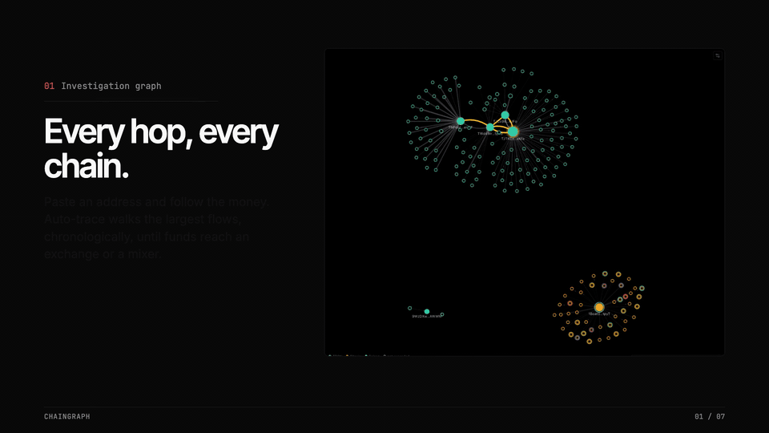
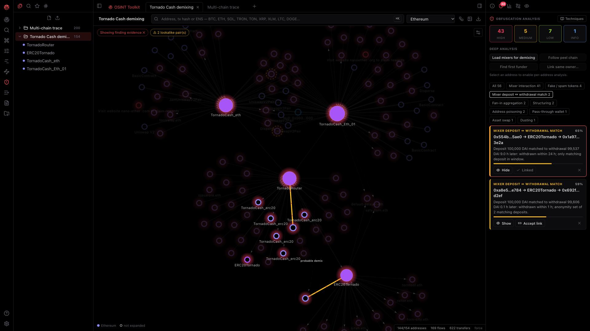
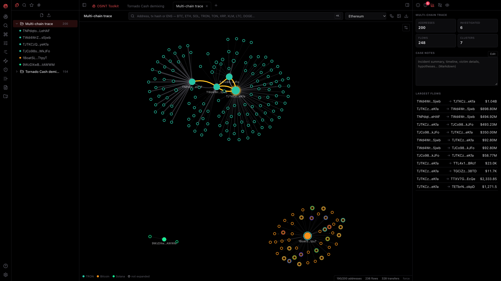
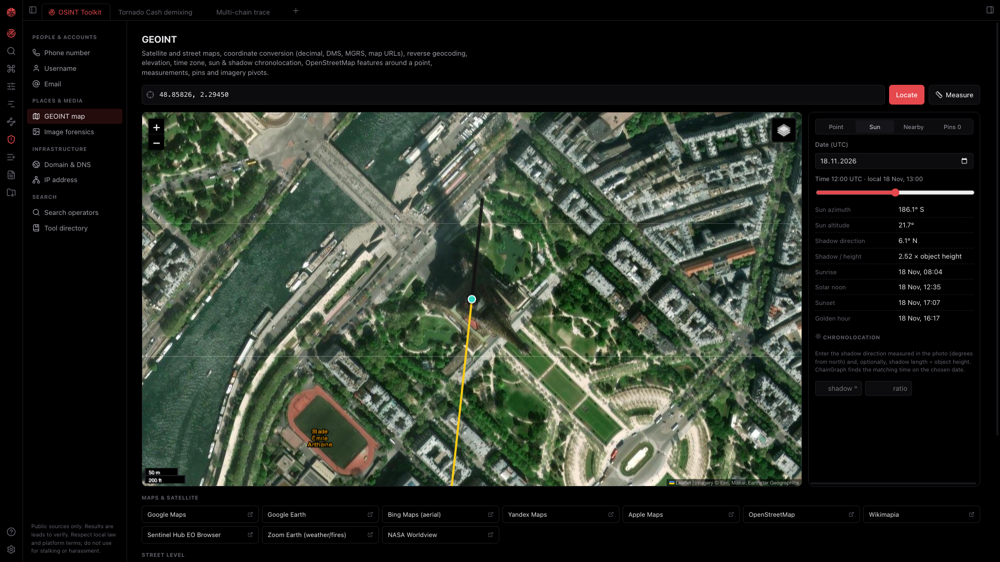
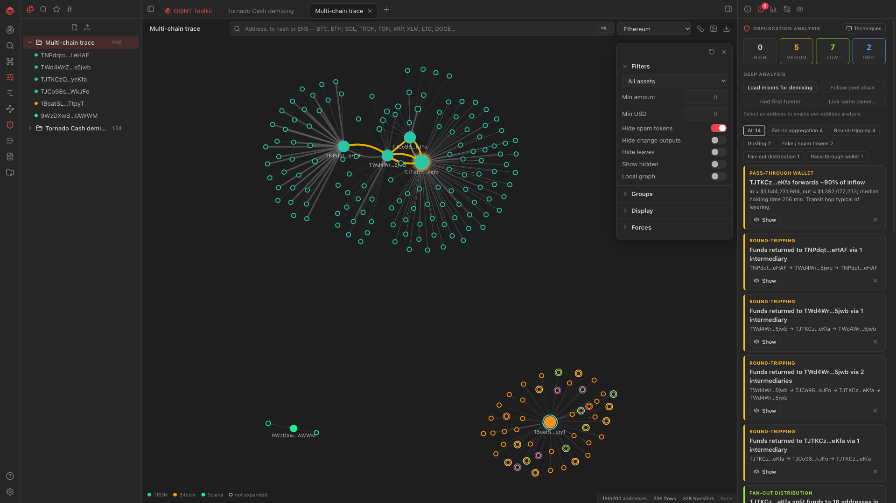

<div align="center">


# ChainGraph

**Crypto forensics and OSINT, in one open-source workspace.**

Trace funds across 20+ blockchains, detect mixers and other laundering techniques, score risk with transparent reasons, and pivot into phone, username, domain, IP, GEOINT and image intelligence. It runs entirely in your browser, with no server, no account and no API keys for the main networks.

[](https://github.com/highstat/chaingraph/actions/workflows/ci.yml)
[](https://highstat.github.io/chaingraph/)
[](LICENSE)

[**Live app**](https://highstat.github.io/chaingraph/) · [**Demo video**](docs/media/demo.mp4) · [Methodology](docs/RESEARCH.md) · [Contributing](CONTRIBUTING.md)

<a href="docs/media/demo.mp4"></a>

</div>

---

## Why

Commercial chain-analysis suites (Chainalysis Reactor, TRM, Arkham, Breadcrumbs) are expensive, closed and server-side. ChainGraph brings their core workflow (graph investigation, attribution, clustering, tracing, risk and exposure) to an open, client-side tool that anyone can audit and run. The interface follows the Obsidian interaction model: vault, tabs, command palette, graph view and Markdown notes.

## Screenshots

| Obfuscation analysis | Multi-chain graph |
|---|---|
|  |  |
| **OSINT toolkit: GEOINT** | **Obsidian-style workspace** |
|  |  |

## Features

### Investigation
- Force, left-to-right flow, top-down and radial layouts; double-click to expand; paginated history
- **Auto-trace**: chronological follow-the-money, ranked in USD, stops at exchanges, mixers and bridges
- **Pathfinding** between any two addresses, an edge transaction log, a timeline with range brush and playback
- Start from an address, a **transaction hash** or an **ENS name**; bulk import

### Obfuscation analysis (17 detectors)
- **Mixers**: verified Tornado Cash contracts plus attribution for Railgun, Sinbad, Privacy Pools and others
- **Demixing**: matches deposits and withdrawals by amount and denomination, time gap, anonymity-set size, address reuse and shared counterparties
- **CoinJoin** detection with implementation guess (Whirlpool, Wasabi 1/2, JoinMarket)
- Peel chains (detect and follow), smurfing fan-out and fan-in, structuring below $10k / $3k, pass-through wallets, round-tripping
- Chain hopping across bridges, the same EVM address on several chains, DEX swaps, instant exchangers
- Dusting, address poisoning, fake and spam tokens; account-model clustering via shared exchange deposit addresses and a common first funder

### Analytics
- Risk score 0–100 with an itemized explanation, direct exposure by category, configurable weights
- UTXO heuristics: common-input clustering and change detection
- Behavioral fingerprint: hour × weekday heatmap and a time-zone estimate
- Your own label library (CSV, TagPack-style); investigator links ("same owner", "probable demix")

### OSINT toolkit
- **Phone**: validation and line type, every format, search dorks, messenger presence, caller-ID and spam databases, telecom records
- **Username**: live checks on 9 open APIs and 75 profile links; **email**: MX, SPF, DMARC, provider and Gravatar
- **Domain**: RDAP, DNS records, subdomains from certificate transparency, archive history; **IP**: geolocation, ASN, Shodan InternetDB, abuse contact
- **GEOINT**: satellite maps, coordinate formats (decimal, DMS, MGRS, map links), sun and shadow chronolocation, OpenStreetMap features around a point, measurements, KML/GeoJSON pins
- **Image forensics**: EXIF and GPS, error level analysis, reverse image search. Files never leave your machine.

### CVE & attack surface (`/cve`)
- **Surface scan** of a domain, IP, range (up to /24) or ASN: DNS, subdomains from certificate transparency, every resolved IP with open ports, software (CPE), tags, ASN and location
- **Deep IP intel**: registered owner and country (whois for every RIR), geolocated city and coordinates, network name and range, RPKI route validity, reverse DNS, abuse contact, FireHOL / Spamhaus DROP / C2 / Tor blocklists
- **Charts**: exposure gauge, CVE priority breakdown, CVSS × EPSS risk matrix with KEV highlighted, CVEs by year, open ports, findings by category, countries (registered vs located), networks and a server map
- **CVE enrichment**: NVD by CPE, FIRST EPSS (with a 30-day trend), CISA KEV, CISA SSVC (exploitation, automatable, impact), Nuclei template availability and public PoC counts. CVEs are ranked by a priority that combines CVSS, EPSS, KEV and SSVC, and are labeled as version-inferred
- **Findings** with reasons and confidence: risky exposed services (RDP, SMB, databases, Docker, ICS…), end-of-life software, KEV hits, missing HTTP security headers, SPF/DMARC, dangling CNAMEs. Overall exposure score and grade
- **Infrastructure graph** linking domains, IPs, networks, software and CVEs
- **CVE intelligence**: look up any CVE or search by keyword, product and version, or CPE, plus the latest CISA KEV additions
- **Stack audit**: paste `package-lock.json`, `requirements.txt`, `go.mod`, `composer.lock`, `Cargo.lock` or a product list. Packages are checked against OSV.dev and products against NVD
- **AI analyst** with your own key: Anthropic, OpenAI, OpenRouter, Groq, DeepSeek, Mistral, Together, local Ollama or LM Studio, or any OpenAI-compatible server. Includes threat assessment, remediation plan and executive summary presets
- **MCP server** (`mcp/`): the same engine as tools for Claude Desktop, Claude Code, Cursor, LM Studio and other MCP clients. `npm run mcp:build`, then see [mcp/README.md](mcp/README.md)
- **Radar** re-scans watched targets on a schedule and logs new hosts, ports, CVEs, KEV entries and subdomains
- Passive only: no packet is sent to the target. Everything runs in the browser, and keys stay in localStorage

### Workspace
- Vault of cases, tabs, sidebars, command palette (⌘P), quick switcher (⌘O), undo and redo
- 9 themes including AMOLED Black, custom accent color; the logo and favicon follow the accent
- Exports: Markdown report, Obsidian vault (.zip), CSV in legal-request format, PNG, JSON

## Networks

| Network | Source | Key |
|---|---|---|
| Bitcoin, Litecoin | mempool.space, litecoinspace.org | none |
| Dogecoin, Bitcoin Cash, Dash, Zcash (transparent) | Blockchair | none |
| Ethereum, Optimism, zkSync Era, Unichain, Rootstock, Mode, Soneium, Lisk, Ink | Blockscout | none |
| TRON (TRX, USDT) | TronGrid, Tronscan | none |
| Solana | PublicNode RPC | none |
| TON | toncenter | none |
| XRP Ledger, Stellar | xrplcluster.com, Horizon | none |
| BNB Chain, Polygon, Arbitrum, Base, Avalanche, Linea, Scroll | Etherscan API V2 | free key |

Monero and Zcash shielded addresses are recognized and explained, since they cannot be traced on-chain.

## Quick start

```bash
git clone https://github.com/highstat/chaingraph.git
cd chaingraph
npm install
npm run dev        # http://localhost:5173
```

`npm run build` produces a static site in `dist/` that you can host anywhere.

## Project structure

```
src/chains/        network adapters, UTXO heuristics, prices
src/obfuscation.ts laundering-pattern detectors
src/analysis.ts    clustering, risk and exposure, pathfinding, behavior
src/entities.ts    attribution rules and verified labels
src/actions.ts     expand, auto-trace, peel chains, funder lookup, watchlist
src/report.ts      Markdown report, Obsidian vault, CSV
src/cve/           attack-surface scan, CVE sources (NVD, EPSS, KEV, OSV…), IP intel, rules, AI, Radar
mcp/               MCP server for AI clients (same engine, Node + stdio)
src/components/    graph, inspector, sidebars, OSINT toolkit, settings
video/             Remotion source of the demo video
docs/              methodology and media
```

The demo video is built with [Remotion](https://www.remotion.dev): `cd video && npm install && npm run dev` opens the editor, and `npm run render` writes `docs/media/demo.mp4`.

## Limits and responsible use

- Attribution and risk scores are heuristic leads, not proof. Totals reflect loaded history; USD uses current prices.
- ChainGraph maps flows between addresses. It does not identify owners: identity can only be established through the relevant service, such as exchange KYC, via lawful process.
- The CVE workspace is passive and is meant for systems you own or are authorized to assess. Banner-inferred CVEs can be false positives when distributions backport fixes. AI mode sends the scan summary to the provider you configure.
- The OSINT toolkit uses public sources only. People-search brokers and breach databases are intentionally not integrated.
- Use it for investigations of fraud and financial crime, journalism, compliance and research. Do not use it to stalk or harass people. See [SECURITY.md](SECURITY.md).

## License

[MIT](LICENSE) © highstat
